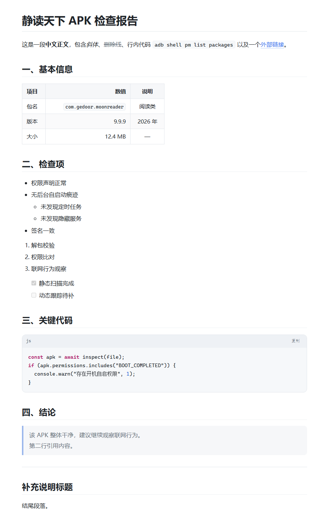

# Markdown 预览器

[](https://github.com/YOGEMOW/md-previewer/releases/latest)
[](LICENSE)

一个**单文件、离线、零依赖**的本地 Markdown 阅读器。双击 HTML 就能用，不需要安装、不需要联网，也不上传任何内容。

- 单文件版：`Markdown预览器.html`（约 53 KB，样式与脚本全部内联，无任何外部请求）
- 可选：在 Windows 上**双击 `.md` 直接用它打开**（提供一键安装/还原脚本）


## 下载

- **推荐**：[Releases](https://github.com/YOGEMOW/md-previewer/releases/latest) 里下载 `md-previewer.html`，双击即用
- 或者直接下载仓库里的 [`Markdown预览器.html`](Markdown预览器.html)（同一份构建，SHA256 一致）

> 说明：GitHub 的 Release 附件会丢弃非 ASCII 文件名，所以附件叫 `md-previewer.html`；它和仓库里的 `Markdown预览器.html` 是同一份文件，改名不影响使用。

## 快速开始

**方式一：直接双击** 下载到的 HTML，然后把 `.md` 文件（或多个文件、整个文件夹）拖进窗口。

**方式二：从文件夹打开**，点「打开文件夹」选择目录 —— 这样正文里用相对路径引用的图片也会自动显示。

支持浅色 / 深色 / 跟随系统三种主题，字号可调，设置会记住。



## 功能

- **排版**：标题（含 Setext）、粗体 / 斜体 / 删除线、行内代码、引用、分隔线、链接、图片、自动链接
- **代码块**：围栏代码块，带轻量语法高亮与「复制」按钮
- **表格**：GFM 表格，支持左 / 中 / 右对齐
- **列表**：有序 / 无序 / 嵌套 / 任务列表（带复选框）
- **阅读辅助**：左侧文件列表（可筛选）+ 文档大纲（点击跳转、滚动高亮）
- **导出**：打印 / 另存为 PDF，自动隐藏界面只留正文
- **源码视图**：一键在渲染结果与原文本之间切换
- **中文友好**：中文段落的软换行按换行显示，西文按空格合并

## 双击 .md 直接打开（Windows）

`bin\` 下有一组可选脚本，把 `.md` / `.markdown` 的默认打开方式指向本预览器：

```
bin\安装关联.cmd     # 双击运行，注册关联（只写 HKCU，不需要管理员权限）
bin\卸载关联.cmd     # 双击运行，一键还原
```

工作原理：资源管理器 → `wscript`（无黑窗）→ `bin\md-open.js` 读取该 `.md`，把相对路径图片内联成 data URI，在 `%TEMP%\md-preview\` 生成预载正文的临时页（自动只保留最近 40 个），再用 Edge 的 `--app` 模式打开成独立窗口。

依赖已安装的 Node.js 与 Edge。关联记录的是绝对路径，**移动仓库目录后重新运行一次 `安装关联.cmd` 即可**。

## 快捷键

| 快捷键 | 作用 |
| --- | --- |
| `Ctrl` + `O` | 打开文件 |
| `Ctrl` + `Shift` + `O` | 打开文件夹 |
| `Ctrl` + `E` | 预览 / 源码切换 |
| `Ctrl` + `+` / `Ctrl` + `-` / `Ctrl` + `0` | 放大 / 缩小 / 重置字号 |
| `Ctrl` + `P` | 打印 / 存为 PDF |

## 目录结构

```
Markdown预览器.html   打包好的单文件版本（分发用这一个即可）
src/
  index.html          开发版入口
  style.css           样式（浅色 / 深色 / 打印）
  md.js               Markdown 解析器（零依赖、纯函数）
  app.js              界面逻辑（打开 / 拖放 / 大纲 / 主题 / 字号）
  build.js            把上面四个文件打包成单文件 HTML
bin/                  Windows 双击关联（启动器 + 安装/还原脚本）
test/
  test-md.js          解析器单元测试（19 项 + 示例文档冒烟）
  fixtures/sample.md  测试用示例文档
  render-test.html    排版自检页
  app-demo.html       界面自检页（自动灌入示例文档）
dev/boot-test.js      用 jsdom 加载打包产物验证交互（31 项）
screenshots/          界面截图
```

## 开发

```bash
cd src
node ../test/test-md.js   # 解析器测试
node build.js             # 重新打包到仓库根目录的 Markdown预览器.html

cd ../dev
npm install               # 安装 jsdom
node boot-test.js         # 界面回归测试
```

`src/` 是唯一的事实来源；改动后重新 `node build.js` 生成单文件版本。

## 已知限制

- 只读预览，不能编辑
- 单独打开一个文件时无法解析相对路径图片（浏览器安全限制），用「打开文件夹」可以
- 数学公式、Mermaid、脚注等扩展语法未支持，会按普通文本显示
- 双击关联脚本仅适用于 Windows

## 许可证

[MIT](LICENSE)

[](https://github.com/deepseek-ai/deepseek-harness)
